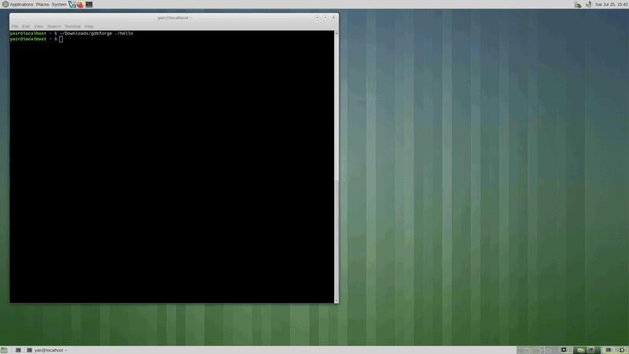
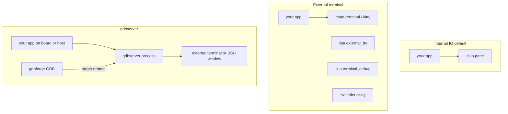

# Debugging Linux applications — local and remote over gdbserver

**gdbforge** is a Vim-inspired **GDB terminal UI** for **user-space** programs — on an **embedded Linux board** or **on the host**. This guide covers **deploy + gdbserver over SSH** (`:lua remotegdb`) and **where program stdin/stdout goes**. For the kernel or a loadable module, where a breakpoint stops the whole system, see [KERNEL_KGDB.md](KERNEL_KGDB.md).

## Prerequisites

Local debugging needs almost nothing; the remote path needs a little setup on both sides.

| Need | Where | Why |
|------|-------|-----|
| gdbforge installed | host | [install](README.md#install) — verify with `gdbforge -version` |
| `gdb` | host | the backend. For a remote board of a different architecture, a **cross** GDB (e.g. `aarch64-linux-gnu-gdb`), selected with `gdbforge -d <gdb>` |
| Your program built with `-g` | host | source-level debugging needs DWARF |
| `gdbserver` on the target | target | `:lua remotegdb` runs it over SSH; most Yocto/Buildroot images ship it |
| **Key-based SSH** to the target | both | every `ssh`/`scp` in the script uses `-o BatchMode=yes`, so **password prompts fail**. Run `ssh-copy-id root@<board>` first |
| Matching unstripped binary on the host | host | the host GDB reads symbols locally while the target runs the stripped copy |
| `GDBFORGE_TERMINAL` (optional) | host | only for the external-terminal I/O mode below |

Quick sanity check before you start:

```bash
ssh -o BatchMode=yes root@<board> 'gdbserver --version'
```

If that prints a version without asking for a password, the remote path will work.

## To your first breakpoint (local program)

```bash
gdbforge ./my_app
```

1. The Code pane opens on your source. Move the cursor to a line and press
   <kbd>Space</kbd> to set a breakpoint.
2. Type `:b gdb` and `run` (or `start`, which breaks at `main` immediately).
3. On the stop, `━━▶` marks the program counter and the Call Stack, Threads and
   Breakpoints panes refresh together. There is no variables pane yet — use
   `print` / `info locals` in `:b gdb`.
4. <kbd>c</kbd> continues, <kbd>n</kbd> steps over, <kbd>s</kbd> steps into, <kbd>f</kbd>
   finishes the frame. Program output lands in `:b io` unless you redirect it below.

For the remote equivalent, jump to [Remote board — `:lua remotegdb`](#remote-board--lua-remotegdb).

## Demo — Linux app I/O

**Linux app** — external terminal print vs the internal IO pane (`:b io`). [Watch on YouTube](https://www.youtube.com/watch?v=Eya_zs4M1Cg).

{ loading=lazy }

## Program I/O — internal vs external

Every debug session has an **inferior** (your app). Its stdin/stdout can go to three places:

### 1. Internal IO pane (default)

- **Pane:** `:b io` (alias `:b output`) inside gdbforge
- **Best for:** line-oriented output, simple `printf`, stdin while stopped or running
- **Setup:** none — works out of the box
- **Limit:** not a full VT100; heavy TUI/curses or flood printing may feel sluggish (Ctrl-C still works)

### 2. External terminal (host)

- **Window:** real emulator (`mate-terminal`, `kitty`, `xterm`, … via `GDBFORGE_TERMINAL`)
- **Best for:** full-screen TUI, curses, high-rate stdout
- **Commands:**
  - `:lua external_tty` — open tty, then `file` / `run` yourself
  - `:lua terminal_debug [prog] [run]` — tty + optional load/break/run
  - `:set inferior-tty` — same idea from the GDB console (no Lua)
  - `:set inferior-tty internal` — switch back to `:b io`
- When external, **`:b io` shows a note only** — type in the other window

```bash
export GDBFORGE_TERMINAL=mate-terminal
./bin/gdbforge ./my_tui
:lua terminal_debug ./my_tui run
```

### 3. gdbserver (inferior in gdbserver's tty)

The debugged program runs **under gdbserver**; its stdio is gdbserver's terminal (local or on the board).

| Script | Target | I/O location |
|--------|--------|--------------|
| `:lua gdbserver_tui [prog] [port]` | **Same PC** | External terminal running local `gdbserver` |
| `:lua remotegdb [app] [host] [port]` | **Board** | SSH opens terminal; gdbserver on board runs the app |
| `:lua remotedlv [app] [host] [port]` | **Board** (Go) | headless `dlv` on board via SSH; see [below](#remote-board-go--lua-remotedlv) |

gdbforge attaches with `target remote`; **breakpoints and stepping** stay in gdbforge panes.



---

## Remote board — `:lua remotegdb`

Deploy binary, start **gdbserver over SSH**, attach with **`target remote`**.

```bash
mkdir -p .gdbforge/lua
cp -r lua/embedded/remotegdb .gdbforge/lua/
export GDBFORGE_REMOTE_HOST=192.168.20.50
export GDBFORGE_TERMINAL=mate-terminal
./bin/gdbforge ./hello
:lua remotegdb
```

```text
:lua remotegdb ./hello 192.168.20.50 1234
```

### Workflow

1. Local app path — arg, `GDBFORGE_REMOTE_APP`, or session program
2. MD5 compare; **scp** only if remote copy missing or stale
3. SSH runs `gdbserver :PORT /tmp/app [args…]` in an external terminal
4. `wait_port` → `file` + `target remote host:PORT`

### Environment variables

| Variable | Default | Meaning |
|----------|---------|---------|
| `GDBFORGE_REMOTE_APP` | _(empty)_ | Local binary |
| `GDBFORGE_REMOTE_APP_ARGS` | _(empty)_ | Inferior argv |
| `GDBFORGE_REMOTE_HOST` | `192.168.20.50` | Board IP |
| `GDBFORGE_REMOTE_USER` | `root` | SSH user |
| `GDBFORGE_REMOTE_PORT` | `1234` | gdbserver port |
| `GDBFORGE_REMOTE_DIR` | `/tmp` | Remote install dir |
| `GDBFORGE_TERMINAL` | auto | Terminal for ssh/gdbserver window |

---

## Remote board, Go — `:lua remotedlv`

Same flow as `remotegdb`, but for a Go program built for the board: deploy, start **headless Delve over SSH**, connect with `dlv_connect`. Needs `dlv` on the target and a session started with the Delve backend.

### How it differs from C/C++ with gdbserver

The idea is the same: the program runs on the board and you drive it from the PC. Who reads the debug info is different:

| | C/C++ (`gdbserver` + host GDB) | Go (headless `dlv` + `dlv connect`) |
|---|---|---|
| Board | `gdbserver` runs the program; it knows nothing about symbols | `dlv exec --headless` runs the program **and reads its DWARF** (symbols, lines, variables) |
| PC | GDB loads the **same ELF** for symbols and source lines | gdbforge is only a client: it needs the **source files**, not the ELF |
| Debug info must be in | the host's copy of the ELF (the board copy can be stripped) | the **board's** copy (Delve reads it there) |

So for Go:

- The binary deployed to the board must keep its debug info. Do not strip it (`-ldflags="-s -w"`), and build with `-gcflags='all=-N -l'` so stepping and variables work.
- The PC needs the source tree at the paths recorded at build time. Building on the PC and running gdbforge from the project directory takes care of that. If you built somewhere else, map the paths in the Delve console with `config substitute-path <build-dir> <local-dir>`.
- The arm64 ELF never runs on the PC. Start `gdbforge -g dlv` with no program and let `:lua remotedlv` deploy and connect.

### Steps

```bash
cp -r lua/embedded/remotedlv .gdbforge/lua/
export GDBFORGE_REMOTE_HOST=192.168.20.50
export GDBFORGE_REMOTE_DLV=/usr/bin/dlv      # where dlv lives on the board
./bin/gdbforge -g dlv                # no program: nothing runs on the PC
:lua remotedlv ./hello-arm64
```

```text
:lua remotedlv ./hello-arm64 192.168.20.50 2345
```

`gdbforge -g dlv` with no program starts an idle Delve session; `:lua remotedlv` fills it by connecting to the board. Passing the arm64 binary at startup instead (`gdbforge -g dlv ./hello-arm64`) runs it with a local `dlv exec` and fails on an x86 PC with `exec format error`.

It uses the same `GDBFORGE_REMOTE_APP`, `_APP_ARGS`, `_HOST`, `_USER` and `_DIR` variables as `remotegdb`, plus:

| Variable | Default | Meaning |
|----------|---------|---------|
| `GDBFORGE_REMOTE_DLV` | `dlv` | Path of `dlv` on the target |
| `GDBFORGE_REMOTE_DLV_PORT` | `2345` | Delve listen port |

The Delve log is `/tmp/dlv.log` on the board.

### Connecting to a dlv that is already running — `-connect`

If `dlv` is already listening on the board (started by hand or by an init script), skip the local program entirely:

```bash
ssh root@192.168.20.50 'dlv exec --headless --listen=:2345 --api-version=2 --accept-multiclient /tmp/hello'
gdbforge -g dlv -connect 192.168.20.50:2345
```

No local program is started. The remote side owns the program's stdio, so `:set inferior-tty` is not available in this mode.

### Getting `dlv` onto an arm64 board

Cross-compile Delve on the host as a static binary and copy it over:

```bash
GOOS=linux GOARCH=arm64 CGO_ENABLED=0 \
  go install github.com/go-delve/delve/cmd/dlv@latest
# result: $(go env GOPATH)/bin/linux_arm64/dlv
scp $(go env GOPATH)/bin/linux_arm64/dlv root@192.168.20.50:/usr/local/bin/dlv
ssh root@192.168.20.50 'chmod +x /usr/local/bin/dlv && dlv version'
export GDBFORGE_REMOTE_DLV=/usr/local/bin/dlv
```

Use a writable location such as `/tmp/dlv` if the root filesystem is read-only. Build your own program for the board with optimizations off so stepping and variables work:

```bash
GOOS=linux GOARCH=arm64 go build -gcflags='all=-N -l' -o hello .
```

For 32-bit ARM use `GOARCH=arm` (plus `GOARM=7`). Other architectures follow the same pattern.

---

## Local host — gdbserver or direct GDB

| `:lua` | Purpose |
|--------|---------|
| `gdbserver_tui` | `gdbserver` in external terminal + `target remote localhost:PORT` |
| `terminal_debug` | Direct GDB + external tty (+ optional file/break/run) |
| `external_tty` | External tty only |
| `remotegdb_log` | Tail `/tmp/gdbserver.log` on board via SSH |

---

## Script install paths

All under [`lua/embedded/`](https://github.com/yairgd/gdbforge/tree/main/lua/embedded):

```bash
cp -r lua/embedded/remotegdb .gdbforge/lua/
cp -r lua/embedded/remotedlv .gdbforge/lua/
cp -r lua/embedded/terminal_debug .gdbforge/lua/
cp -r lua/embedded/external_tty .gdbforge/lua/
cp -r lua/embedded/gdbserver_tui .gdbforge/lua/
```

Kernel debug (not user-space): [KERNEL_KGDB.md](KERNEL_KGDB.md). PTY details: [PTY_ARCHITECTURE.md](PTY_ARCHITECTURE.md).

See also: [Lua catalog — embedded](https://github.com/yairgd/gdbforge/blob/main/lua/embedded/README.md) · [User Guide — Lua](USER_GUIDE.md)
